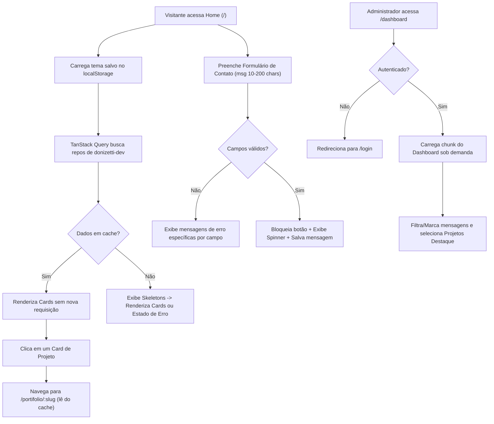

# Especificação Consolidada — Portfólio Pessoal (Donizetti Batista)

> [!IMPORTANT]
> Este documento consolida todas as definições extraídas de `docs/referencias/sobre_mim.md`, `docs/referencias/requisitos_principais.md` e das duas rodadas da entrevista de Discovery.

---

## 1. Objetivos e Escopo do Projeto

### 1.1 Objetivo Geral
Desenvolver um portfólio web profissional, autêntico, responsivo e de alta performance para **Donizetti Batista** (`donizetti-dev`), posicionando sua atuação como **Analista de Automação RPA na MV3 Tecnologia** e estudante de **Engenharia de Software na FIAP**, com forte domínio em **Python, Automação (Selenium, Playwright, AutoMate, Power Automate, PowerShell), APIs/Backend (Flask, FastAPI), Processamento de Dados/Documentos (SQL Server, Pandas, PDFPlumber, OpenPyXL) e Desenvolvimento Web (React/JS)**.

### 1.2 Escopo e Ajustes Alinhados no Discovery
* **Exclusão de Projetos Confidenciais/IA Generativa:** Conforme alinhado, os projetos internos da MV3 e o Assistente de IA com Gemini **não** serão expostos como repositórios públicos nem terão menção a IA generativa. A atuação na **MV3 Tecnologia** será destacada em uma seção dedicada de **Experiência & Engenharia de Automação**, detalhando o ferramental técnico (Python, Selenium, SQL Server, AutoMate, Power Automate Desktop e PowerShell).
* **Manutenibilidade e Adição Simples de Cards:** Os projetos serão carregados dinamicamente da API do GitHub (`donizetti-dev`), mas a arquitetura contará com um arquivo centralizado de curadoria/extensão (`src/config/projectsCatalog.ts`) que permite adicionar novos cards extras, sobrescrever descrições ou fixar tags em segundos, apenas editando uma lista tipada, sem alterar componentes visuais.
* **Ajuste de Regra no Formulário de Contato (Mudança de Escopo Solicitada):** O exemplo original em `docs/referencias/requisitos_principais.md` citava mínimo de 20 caracteres na mensagem; por solicitação explícita no Discovery, a regra oficial passa a ser **mínimo de 10 e máximo de 200 caracteres**, acompanhada de um **contador de caracteres em tempo real (`0/200`)**.

---

## 2. Requisitos Funcionais (RF) e Não Funcionais (RNF)

### 2.1 Requisitos Funcionais
* **RF01 — Integração Dinâmica com GitHub + Catálogo Extensível:** Buscar automaticamente os repositórios públicos do usuário `donizetti-dev` via GitHub REST API, exibindo nome, descrição, linguagem principal, data da última atualização e links, mesclados com o catálogo local para fácil manutenção e adição de novos cards.
* **RF02 — Página Individual de Projeto:** Cada card de projeto deve navegar para sua rota exclusiva (`/portifolio/:slug`), apresentando metadados completos do repositório, tecnologias utilizadas, data de atualização, status e links diretos (código-fonte no GitHub e deploy/demo quando disponível), sem necessidade de renderizar o `README.md`.
* **RF03 — Tratamento de Erros e 404 Amigável:**
  * Rota inexistente: Página 404 com retorno visual integrado à identidade do site e a mensagem amigável (ex.: *"Ops, essa página ainda não existe!"*) + botão de retorno à Home.
  * Falha na API: Banner/estado de erro amigável (ex.: *"Ops, tivemos um problema para carregar alguns dados, nossos devs já estão trabalhando nisso!"*) com botão de *"Tentar novamente"*.
* **RF04 — Estados Assíncronos Completos:** Todos os consumos de API (GitHub, envio de contato e Dashboard) devem apresentar estados visuais claros de **Carregamento** (*skeletons* nos cards de projeto, *spinner* nos botões), **Erro** e **Lista Vazia** (*empty state*).
* **RF05 — Formulário de Contato com Validação e Contador:**
  * Campos:
    * `nome`: obrigatório, mínimo de 3 caracteres (*"Informe seu nome com pelo menos 3 caracteres"*).
    * `email`: obrigatório, formato de e-mail válido (*"E-mail inválido"*).
    * `assunto`: obrigatório, mínimo de 5 caracteres (*"O assunto deve ter no mínimo 5 caracteres"*).
    * `mensagem`: obrigatória, entre **10 e 200 caracteres** (*"A mensagem deve ter entre 10 e 200 caracteres"*), com contador visual `X/200`.
  * Bloqueio do botão de envio (`disabled`) enquanto a requisição estiver em andamento para impedir envios duplicados.
* **RF06 — Autenticação e Proteção do Dashboard:** Rota administrativa protegida por login (`/login` -> `/dashboard`). Visitantes não autenticados que tentarem acessar `/dashboard` são redirecionados automaticamente para `/login`.
* **RF07 — Gestão de Mensagens no Dashboard:** Listagem de todas as mensagens recebidas pelo formulário de contato, permitindo:
  * Marcar/desmarcar mensagem como **Respondida**.
  * Marcar/desmarcar mensagem como **Importante**.
  * Filtrar mensagens por: *Todas*, *Não respondidas* e *Respondidas*.
* **RF08 — Seleção de Projetos em Destaque na Home:** No Dashboard, o administrador pode selecionar quais projetos aparecem na seção de "Destaques" da Home.
* **RF09 — Preferência de Tema (Claro/Escuro):** Alternância entre *Dark Mode* (padrão `#000000`) e *Light Mode Monocromático* (`#F7F7F7`), persistida no `localStorage` entre visitas.

### 2.2 Requisitos Não Funcionais
* **RNF01 — Identidade Visual Monochrome High-Contrast:**
  * **Dark Mode:** Fundo `#000000` com grid técnico translúcido; superfícies em `rgba(32, 32, 32, 0.8)` com `backdrop-filter: blur`; bordas em `rgba(255, 255, 255, 0.22)` com *glow* no hover; textos em `#FFFFFF` e cinza neutro de alto contraste.
  * **Light Mode:** Fundo `#F7F7F7` com grid grafite sutil; superfícies em `rgba(255, 255, 255, 0.85)`; bordas em `rgba(10, 10, 10, 0.18)` com destaque no hover; textos em `#0A0A0A` e cinza chumbo.
* **RNF02 — Tipografia e Semântica HTML:** Fontes `Syne` (títulos H1/H2 com variação preenchida e vazada `-webkit-text-stroke`), `Inter` (corpo de texto) e `JetBrains Mono` (metadados, tags, contadores e menus). Uso rigoroso de tags semânticas (`<header>`, `<nav>`, `<main>`, `<section>`, `<article>`, `<footer>`).
* **RNF03 — Efeitos Visuais Avançados e Elemento 3D Leve:**
  * Elemento 3D minimalista na Home (geometria técnica wireframe em Canvas HTML5 3D procedural < 4 KB) que reage suavemente à rolagem (*scroll*).
  * *Glassmorphism & Spotlight* radial acompanhando o cursor nos cards (apenas dispositivos com ponteiro fino).
  * *Split Effect* (`clip-path`) decorativo nas camadas de borda dos cards de projeto sem comprometer a leitura do texto.
  * *Tipografia Cinética (Marquee)* horizontal em segundo plano e *Tilt 3D* (`perspective`, `transform-style: preserve-3d`) em cards/skills.
* **RNF04 — Performance (Lighthouse Mobile ≥ 80):**
  * Code-splitting obrigatório (`React.lazy` + `Suspense`) para a rota `/dashboard` e para o componente 3D da Home.
  * Reserva de espaço estático (*aspect-ratio* / dimensões mínimas) para evitar qualquer salto de layout (*CLS = 0*).
  * Cache em memória das requisições à API do GitHub (zero chamadas repetidas ao navegar entre Home e páginas de projetos).
  * Imagens/ícones otimizados com `loading="lazy"`.
* **RNF05 — Qualidade, Padronização e Segurança:**
  * Testes automatizados E2E com **Playwright** cobrindo validação do formulário de contato e bloqueio de acesso não autenticado ao `/dashboard`.
  * Lint e formatação automáticos via **ESLint + Prettier + Husky + lint-staged** antes de cada commit.
  * Credenciais isoladas em `.env` com modelo documentado em `.env.example`.

---

## 3. Estrutura de Páginas e Rotas

| Rota | Página / Componente | Carregamento | Acesso | Descrição |
| :--- | :--- | :--- | :--- | :--- |
| `/` | `HomePage` | Inicial (com `Hero3D` em *lazy*) | Público | Hero com detalhe 3D, Marquee, Sobre & Experiência (MV3 + FIAP), Skills por categoria, Projetos em Destaque + Repositórios GitHub e Formulário de Contato. |
| `/portifolio/:slug` | `ProjectDetailPage` | Sob demanda / Rápido | Público | Página dedicada do projeto com dados do GitHub/catálogo, stack, datas, status e links externos. |
| `/login` | `LoginPage` | `React.lazy` | Público | Tela de autenticação administrativa para acesso ao Dashboard. |
| `/dashboard` | `DashboardPage` | `React.lazy` | **Protegido (Admin)** | Painel administrativo para leitura/filtro/marcação de mensagens e seleção de projetos em destaque na Home. |
| `*` | `NotFoundPage` | Inicial | Público | Página 404 amigável (*"Ops, essa página ainda não existe!"*) com retorno rápido. |

---

## 4. Fluxos Principais do Usuário



---

## 5. Arquitetura e Tecnologias Escolhidas

1. **Vite + React 18 + TypeScript:** Inicialização instantânea, *tree-shaking* eficiente para garantir pacotes enxutos no mobile e tipagem estrita para evitar erros em tempo de execução.
2. **React Router DOM (v6):** Gerenciamento declarativo das rotas (`/`, `/portifolio/:slug`, `/login`, `/dashboard`, `*`) com suporte nativo a `ProtectedRoute` e *code-splitting*.
3. **TanStack Query (`@tanstack/react-query`):** Configurado com `staleTime: 1000 * 60 * 10` (10 minutos) e `gcTime: 1000 * 60 * 30`. Garante que a chamada para `https://api.github.com/users/donizetti-dev/repos` ocorra **apenas uma vez por sessão**, eliminando requisições redundantes ao navegar entre a Home e `/portifolio/:slug`.
4. **Supabase (`@supabase/supabase-js`) + Adaptador de Fallback Local:**
   * **Modo Cloud (quando `VITE_SUPABASE_URL` e `VITE_SUPABASE_ANON_KEY` estão definidos):** Usa Supabase Auth e PostgreSQL com Row Level Security (RLS).
   * **Modo Local/Fallback (quando variáveis não estão preenchidas ou em testes E2E):** Usa um repositório local persistido em `localStorage` com a mesma interface assíncrona (`IDataProvider`), permitindo testar e adicionar dados localmente sem travar o desenvolvimento.
5. **CSS Modules + CSS Custom Properties (Variáveis Nativas):** Zero overhead de runtime JS, controle total de `clip-path`, `-webkit-text-stroke`, `backdrop-filter`, `perspective` e troca instantânea entre *Dark Mode* e *Light Mode*.
6. **Playwright + ESLint + Prettier + Husky:** Automação dos testes obrigatórios em navegador real e validação de código no *git pre-commit*.

---

## 6. Estrutura Inicial de Pastas

```text
Portifolio---WebDev/
├── docs/
│   ├── referencias/                 # Documentos originais (sobre_mim.md, requisitos_principais.md)
│   └── specs/                       # Especificação consolidada (especificacao_geral.md)
├── public/                          # Favicon e assets estáticos otimizados
├── src/
│   ├── assets/                      # Ícones/vetores leves
│   ├── components/                  # Componentes visuais reutilizáveis (PascalCase)
│   │   ├── ui/                      # Button, Card, Badge, Skeleton, EmptyState, ErrorState, ThemeToggle
│   │   ├── layout/                  # Header, Footer, PageLayout, MarqueeBanner
│   │   ├── home/                    # HeroSection, HeroCanvas3D (lazy), ExperienceSection, SkillsSection
│   │   ├── projects/                # ProjectCard (Split/Spotlight), ProjectsGrid
│   │   └── contact/                 # ContactForm (com contador 10-200 chars)
│   ├── config/
│   │   ├── profileData.ts           # Dados profissionais (MV3, FIAP, Skills, links sociais)
│   │   └── projectsCatalog.ts       # Catálogo fácil para adicionar/customizar cards de projetos
│   ├── context/
│   │   ├── ThemeContext.tsx         # Persistência e alternância Claro/Escuro
│   │   └── AuthContext.tsx          # Estado de sessão do Administrador
│   ├── hooks/                       # Hooks personalizados (camelCase iniciando com 'use')
│   │   ├── useGitHubProjects.ts     # Hook TanStack Query + merge com projectsCatalog
│   │   ├── useContactMessages.ts    # Hook para envio e gestão de mensagens
│   │   ├── useFeaturedProjects.ts   # Hook para leitura/atualização de destaques da Home
│   │   └── useSpotlight.ts          # Hook para efeito de luz radial e tilt 3D em desktop
│   ├── pages/                       # Páginas associadas às rotas
│   │   ├── HomePage.tsx
│   │   ├── ProjectDetailPage.tsx
│   │   ├── LoginPage.tsx
│   │   ├── DashboardPage.tsx
│   │   └── NotFoundPage.tsx
│   ├── routes/
│   │   ├── AppRoutes.tsx            # Definição de rotas e React.lazy
│   │   └── ProtectedRoute.tsx       # Guarda de rota do Dashboard
│   ├── services/                    # Camada de acesso a dados e APIs externas
│   │   ├── githubService.ts         # Cliente REST da API do GitHub
│   │   ├── supabaseClient.ts        # Inicialização segura do Supabase
│   │   └── dataService.ts           # Serviço unificado (Supabase + Fallback Local)
│   ├── styles/
│   │   ├── variables.css            # Tokens de cores (Dark/Light), fontes e espaçamentos
│   │   └── global.css               # Reset, grid de fundo e utilitários tipográficos
│   ├── types/                       # Contratos e interfaces TypeScript
│   │   └── index.ts
│   ├── App.tsx
│   └── main.tsx
├── tests/                           # Testes automatizados E2E (Playwright)
│   ├── contact-form.spec.ts         # Validação de campos, contador e envio
│   └── dashboard-auth.spec.ts       # Bloqueio sem login, login e ações do dashboard
├── .env.example                     # Template de variáveis de ambiente
├── playwright.config.ts
├── package.json
└── README.md                        # Documentação técnica, convenções e guia de manutenção
```

---

## 7. Modelo de Dados e Integrações Externas

### 7.1 API do GitHub + Catálogo Local (`ProjectItem`)
Os dados vindos de `GET https://api.github.com/users/donizetti-dev/repos?sort=updated` são normalizados e combinados com `src/config/projectsCatalog.ts`:

```typescript
export interface ProjectItem {
  id: string;
  slug: string;                // Ex: "news-scraper-api" -> rota /portifolio/news-scraper-api
  name: string;                // Nome amigável ou nome do repositório
  description: string;         // Descrição do GitHub ou sobrescrita no catálogo
  language: string;            // Linguagem principal (ex: "Python", "JavaScript")
  topics: string[];            // Tecnologias/tags associadas
  updatedAt: string;           // Data ISO da última atualização
  repoUrl: string;             // Link do repositório no GitHub
  homepageUrl?: string;        // Link de deploy (ex: Vercel), se houver
  isFeatured?: boolean;        // Definido dinamicamente pelo Dashboard
}
```
> [!TIP]
> **Facilidade para adicionar novos cards:** Para incluir um novo projeto manual ou customizar um repositório existente do GitHub, basta adicionar um item no array `CUSTOM_PROJECTS_CATALOG` em `src/config/projectsCatalog.ts`. A listagem, filtros, rota `/portifolio/:slug` e o seletor de destaques do Dashboard reconhecerão o card automaticamente.

### 7.2 Modelo de Dados Persistidos (Supabase / Storage Service)

1. **Tabela `contact_messages` (Mensagens de Contato):**
   * `id` (`uuid`, PK)
   * `name` (`text`, not null)
   * `email` (`text`, not null)
   * `subject` (`text`, not null)
   * `message` (`text`, not null — 10 a 200 caracteres)
   * `is_answered` (`boolean`, default `false`)
   * `is_important` (`boolean`, default `false`)
   * `created_at` (`timestamptz`, default `now()`)

2. **Tabela `site_settings` / `featured_projects` (Destaques da Home):**
   * `id` (`text`, PK — `'featured_slugs'`)
   * `slugs` (`text[]` — lista de slugs dos projetos marcados como destaque)
   * `updated_at` (`timestamptz`)

---

## 8. Estratégia de Autenticação e Autorização

* **Proteção de Rota no Frontend:** O componente `ProtectedRoute` verifica a sessão ativa no `AuthContext`. Caso não exista sessão válida, redireciona imediatamente para `/login` com `replace: true`.
* **Proteção de Dados no Backend (Supabase RLS):**
  * `contact_messages`: Política `INSERT` liberada para `anon` (visitantes enviarem mensagens); políticas `SELECT`, `UPDATE` e `DELETE` restritas exclusivamente a `authenticated` (administrador).
  * `featured_projects`: Política `SELECT` liberada para `anon`; política `UPDATE/UPSERT` restrita a `authenticated`.
* **Credenciais Seguras:** Nenhuma senha ou chave privada fica exposta no código-fonte. Variáveis configuradas via `.env` (`VITE_GITHUB_USERNAME`, `VITE_SUPABASE_URL`, `VITE_SUPABASE_ANON_KEY`, e credenciais de teste para o ambiente local documentadas no `.env.example`).

---

## 9. Estratégia de Testes Automatizados (Playwright)

Utilizaremos **Playwright** executando contra o servidor da aplicação para validar os fluxos críticos reais:

1. **Suíte 1 — Formulário de Contato (`tests/contact-form.spec.ts`):**
   * Verifica exibição das mensagens de erro específicas ao tentar submeter campos vazios ou inválidos (*"E-mail inválido"*, *"A mensagem deve ter entre 10 e 200 caracteres"*).
   * Verifica o funcionamento do contador de caracteres (`X/200`) em tempo real.
   * Verifica que o botão de envio fica desabilitado (`disabled`) e exibe indicador de carregamento durante o envio de um formulário válido.
2. **Suíte 2 — Segurança do Dashboard e Rotas (`tests/dashboard-auth.spec.ts`):**
   * Verifica que acessar `/dashboard` sem estar logado bloqueia a visualização e redireciona para `/login`.
   * Verifica que o login administrativo permite acessar o `/dashboard`, filtrar mensagens (respondidas / não respondidas) e alternar projetos em destaque.
   * Verifica que acessar uma rota inexistente (ex.: `/rota-que-nao-existe`) renderiza a página 404 amigável.

---

## 10. Critérios de Desempenho e Qualidade

* **Lighthouse Mobile Performance ≥ 80:**
  * Pacote inicial enxuto: `DashboardPage` e `HeroCanvas3D` segregados via `React.lazy`.
  * Fontes (`Syne`, `Inter`, `JetBrains Mono`) carregadas com `font-display: swap` e `preconnect`.
  * Canvas 3D limitado a `requestAnimationFrame` pausado automaticamente quando fora da *viewport* (`IntersectionObserver`), economizando bateria e CPU no mobile.
  * Efeitos de *Spotlight* e *Tilt 3D* ativados somente em dispositivos com `@media (hover: hover) and (pointer: fine)`.
* **Zero Layout Shift (CLS = 0):** Containers do Canvas 3D e dos skeletons de projetos possuem dimensões reservadas fixas/proporcionais antes do carregamento.

---

## 11. Riscos Técnicos e Mitigações

| Risco Técnico | Impacto | Mitigação Arquitetural |
| :--- | :--- | :--- |
| **Rate Limit da API pública do GitHub (60 req/h por IP)** | Falha ao carregar projetos após muitos recarregamentos seguidos | Cache via TanStack Query + persistência de backup do último payload válido no `sessionStorage` + catálogo estático de contingência. |
| **Queda de FPS em celulares por excesso de `backdrop-filter: blur`** | Nota baixa no Lighthouse Mobile | Redução do raio de `blur` em viewports mobile (`@media (max-width: 768px)`) e uso de superfícies translúcidas otimizadas com aceleração de hardware (`transform: translateZ(0)`). |
| **Ambiente avaliado sem conta Supabase configurada** | Formulário ou Dashboard falharem por falta de `.env` | Implementação do `dataService` híbrido: se o `.env` não tiver chaves do Supabase, opera automaticamente com banco local simulado em `localStorage` sem quebrar nenhuma funcionalidade. |

---

## 12. Separação entre MVP, Melhorias Futuras e Opcionais

* **MVP (Escopo Obrigatório desta Entrega):**
  * Todas as 11 exigências de `docs/referencias/requisitos_principais.md`, incluindo identidade *Monochrome High-Contrast* (Dark & Light), detalhe 3D leve na Home, efeitos CSS (*Glassmorphism*, *Spotlight*, *Split Effect*, *Marquee*, *Tilt*), integração GitHub com cache, seção de experiência na MV3 Tecnologia e FIAP, rotas dinâmicas `/portifolio/:slug`, página 404 amigável, formulário de contato validado (10–200 chars com contador), Dashboard protegido por login, testes Playwright e automação de lint/format.
* **Melhorias Futuras / Pós-MVP (Opcionais):**
  * Notificação automática por e-mail/webhook (ex.: Resend ou Discord Webhook) quando uma nova mensagem cair no Dashboard.
  * Internacionalização (PT-BR / EN).
  * Métricas de visualizações por projeto no Dashboard.

---

## 13. Matriz de Rastreabilidade de Requisitos

| ID Origem (`requisitos_principais.md`) | Requisito Original | Solução Proposta na Especificação | Forma de Validação |
| :--- | :--- | :--- | :--- |
| **Req 1.1** | Rota para cada projeto (ex.: `portifolio/api-python`) | Rota dinâmica `/portifolio/:slug` no React Router (`ProjectDetailPage.tsx`). | Navegação em tela + Teste E2E Playwright. |
| **Req 1.2** | Tratamento de 404 amigável e falha na API | `NotFoundPage.tsx` para rota `*` e componente `ErrorState.tsx` com frase amigável quando a API falhar. | Teste Playwright acessando rota inexistente e simulando erro de rede. |
| **Req 2** | Estados de carregamento (skeleton/spinner), erro, lista vazia e bloqueio de botão no envio | Componentes `ProjectCardSkeleton`, `EmptyState`, `ErrorState` e estado `isSubmitting` desabilitando o botão de envio com spinner. | Teste Playwright de submissão do formulário e inspeção de estados da UI. |
| **Req 3** | Projetos carregados pela API do GitHub sem cadastro manual (descrição, linguagem, última atualização) | `githubService.ts` consumindo `users/donizetti-dev/repos` + `projectsCatalog.ts` para fácil extensão futura. | Verificação do carregamento real da conta `donizetti-dev` e exibição nos cards. |
| **Req 4** | Formulário de contato com validação por campo e mensagens específicas | `ContactForm.tsx` validando nome, e-mail, assunto e mensagem (ajustado para **10 a 200 caracteres + contador**, conforme solicitado). | Suíte Playwright `tests/contact-form.spec.ts`. |
| **Req 5** | Dashboard protegido por login (listar mensagens, marcar respondida/importante, filtrar e destacar projetos na Home) | `ProtectedRoute.tsx` + `DashboardPage.tsx` integrado ao `dataService.ts` (Supabase Auth/DB + fallback local). | Suíte Playwright `tests/dashboard-auth.spec.ts`. |
| **Req 6** | Tema claro/escuro persistido entre visitas | `ThemeContext.tsx` salvando preferência em `localStorage` e aplicando atributo `data-theme="dark\|light"` no `documentElement`. | Alternar tema, recarregar página e validar persistência. |
| **Req 7** | Layout responsivo, componentes reaproveitados e elementos 3D interativos na Home | Sistema de design em `src/components/ui/` + `HeroCanvas3D.tsx` leve reagindo ao scroll. | Testes em viewports mobile (375px) e desktop (1440px). |
| **Req 8** | Performance Lighthouse Mobile ≥ 80, lazy load de imagens/3D/Dashboard, zero CLS e zero requisições repetidas ao GitHub | `React.lazy` para `/dashboard` e `HeroCanvas3D`, TanStack Query (`staleTime: 10min`) e containers com dimensões reservadas. | Build de produção + auditoria de performance e aba Network. |
| **Req 9** | Testes automatizados cobrindo validação do formulário e bloqueio do dashboard sem login | Testes E2E com **Playwright** em `tests/contact-form.spec.ts` e `tests/dashboard-auth.spec.ts`. | Execução real via `npx playwright test`. |
| **Req 10** | Arquitetura clara (`components`, `pages`, `services`, `hooks`), convenções no README e lint/formatação antes do commit | Estrutura modular em `src/`, documentação no `README.md` e configuração de ESLint + Prettier + Husky. | Execução de `npm run lint`, `npm run format:check` e `npm run build`. |
| **Req 11** | Dados sigilosos em `.env` acompanhado de `.env.example` | Variáveis `VITE_*` isoladas no `.env` (ignorado pelo Git) e documentadas em `.env.example`. | Verificação do `.gitignore` e `.env.example`. |
| **Front-End 1, 2, 3** | Paleta Monochrome High-Contrast, fontes `Syne`/`Inter`/`JetBrains Mono`, HTML semântico, Glassmorphism, Spotlight, Split Effect, Marquee e Tilt 3D | Implementação em `variables.css`, `global.css`, `ProjectCard.module.css` e hook `useSpotlight.ts`. | Inspeção visual e validação de tags semânticas HTML5. |

